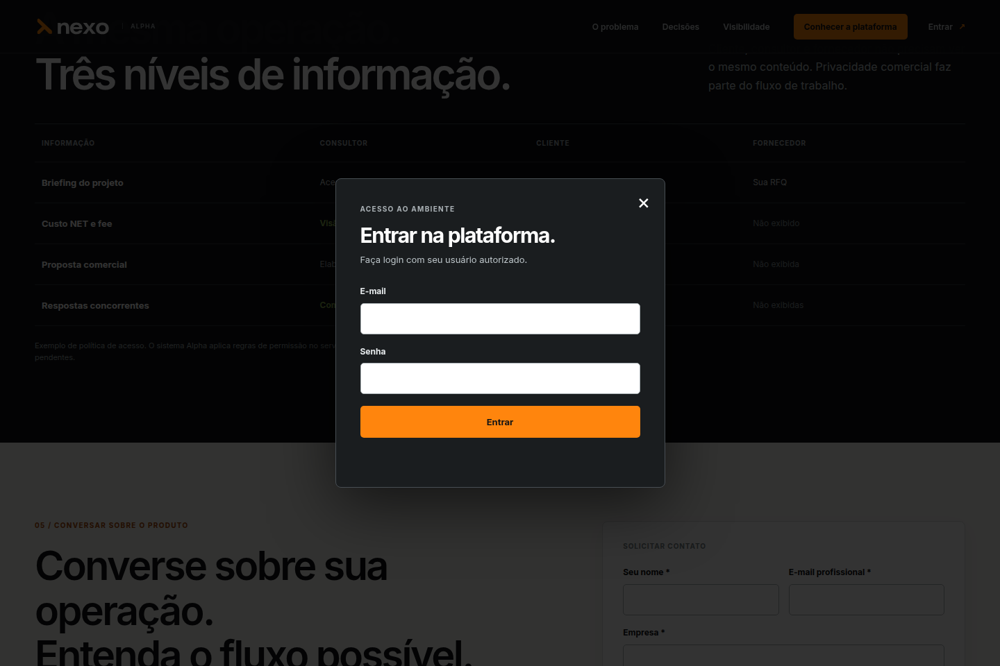
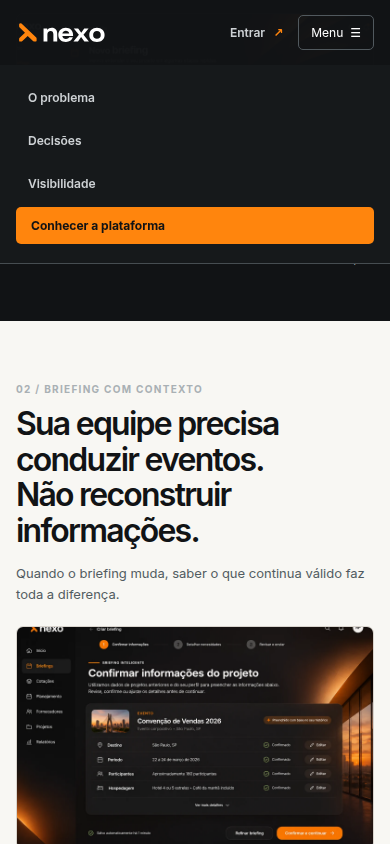

# Galeria de capturas — NEXO Alpha (nome provisório)

**Direção:** homepage produto como protagonista. **Data editorial:** 2026-11-23.  
**Fonte:** navegador Chromium executando a homepage real da branch de revisão via FastAPI local.  
**Dados:** fictícios e rotulados. Não são telas do workspace final nem de um produto em produção.

O pipeline `.github/workflows/alpha-evidence.yml` gera estas imagens a cada revisão visual relevante e salva o manifesto com commit/viewport.

## 1. Hero — desktop (1440 × 960)

## 2. Homepage completa — desktop

## 3. Matriz de cotação

## 4. Formulário de demonstração

## 5. Login

## 6. Mobile completo — 390 × 844

## 7. Menu mobile

[Consultar manifesto técnico](manifest.json).

**Observação:** a imagem da homepage contém informações comerciais de exemplo. O fluxo de login/lead deve ser homologado com backend antes da publicação. Screenshots não substituem testes.
