# Galeria de capturas — direção editorial B + workspace operacional V2

**Atualizado:** 2026-11-24 (America/Sao_Paulo)  
**Fonte:** Chromium real via FastAPI local, com dados de demonstração e autenticação no workspace.  
**Estado:** branch de revisão; não é produto publicado ou homologado.

> A execução do pipeline deve produzir os arquivos abaixo e atualizar `manifest.json`. Se a imagem estiver ausente, consulte a execução mais recente do GitHub Actions. Não substitua capturas por renders conceituais.

## Homepage — direção editorial B

### Hero editorial
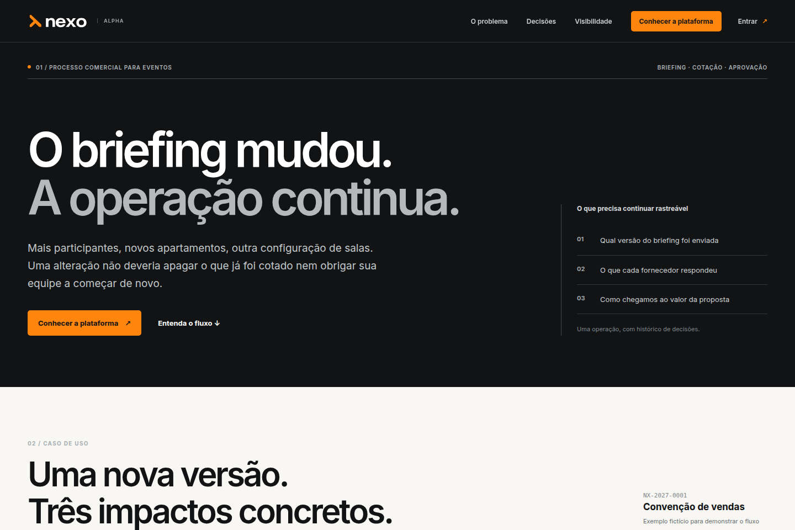

### Primeira rolagem desktop — nova imagem original do briefing
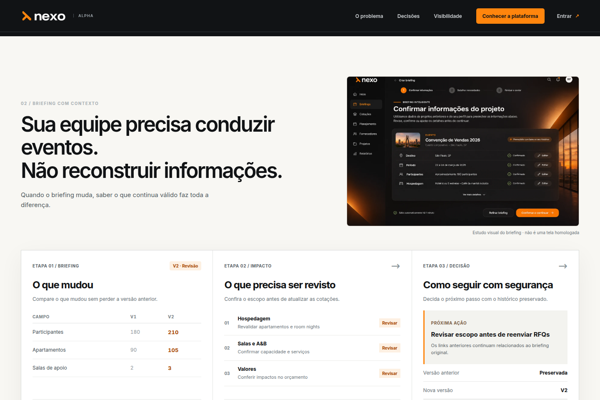

### Hero mobile — nova copy e foto original do sistema
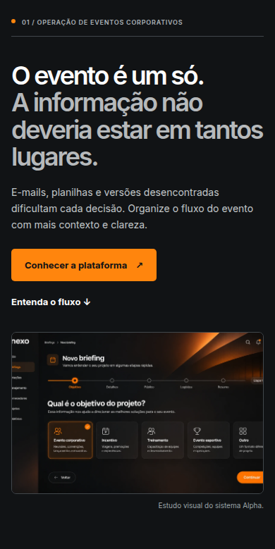

### Primeira rolagem mobile — briefing
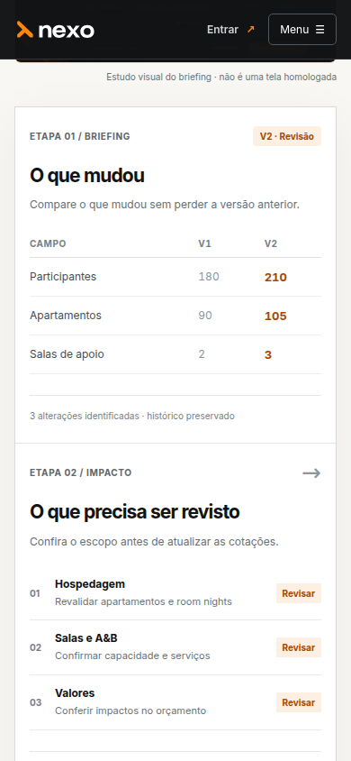

### Página completa desktop
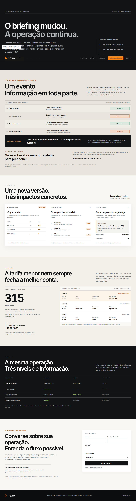

### Explicação financeira
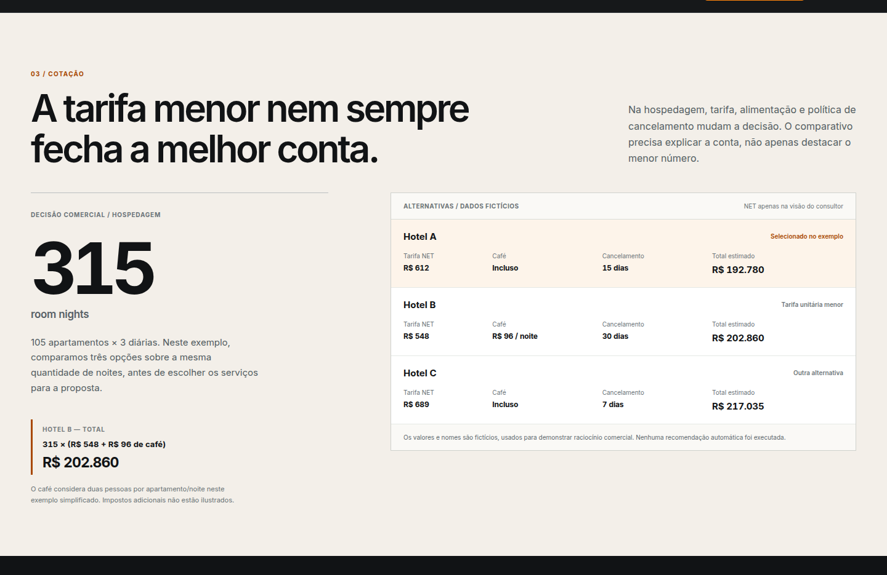

### Contato, login e mobile
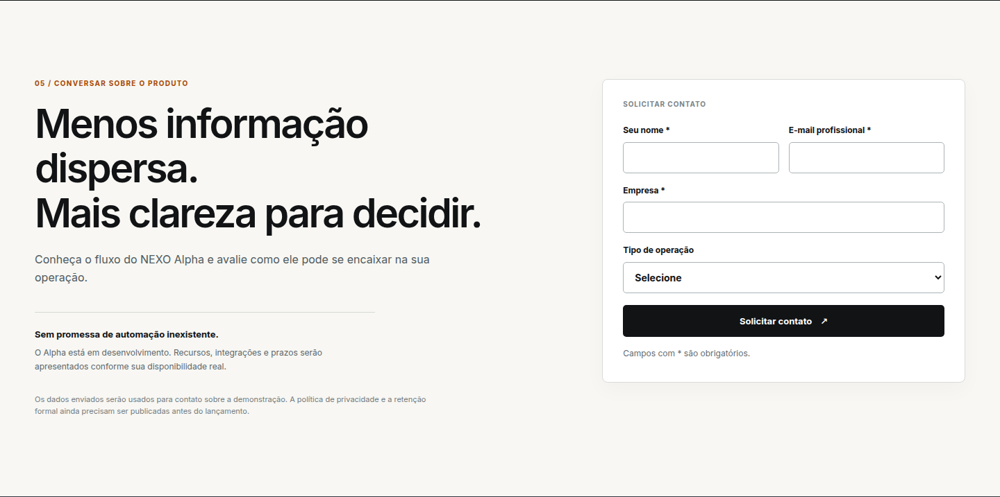

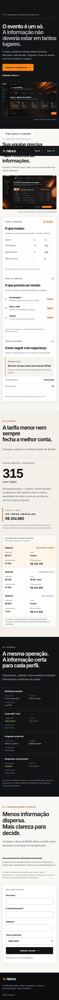

## Workspace operacional — interface nova

Estas capturas representam código executado com sessão de demonstração e banco efêmero.

### Fila de operações
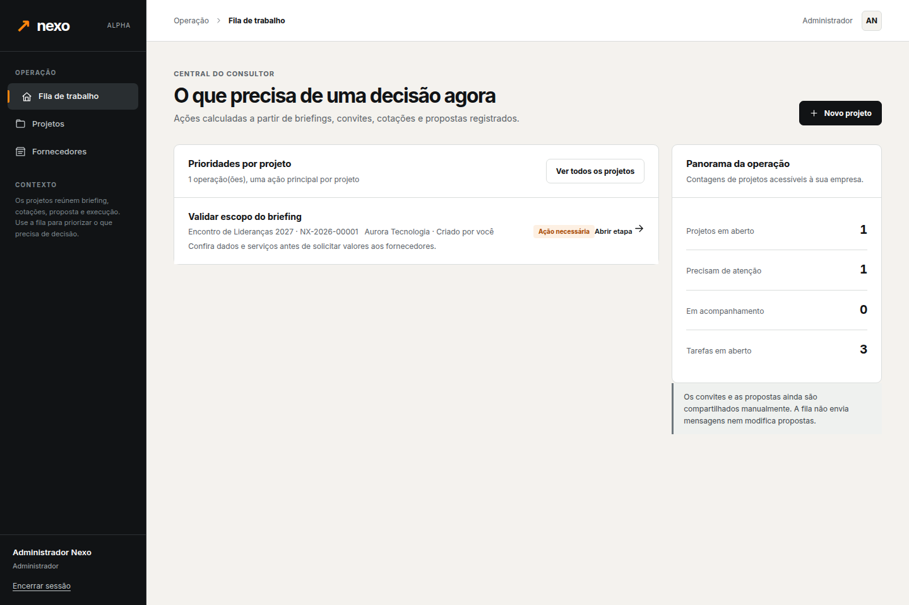

### Contexto completo de projeto
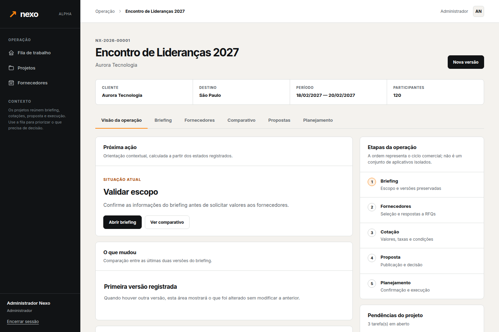

### Cotação com origem financeira
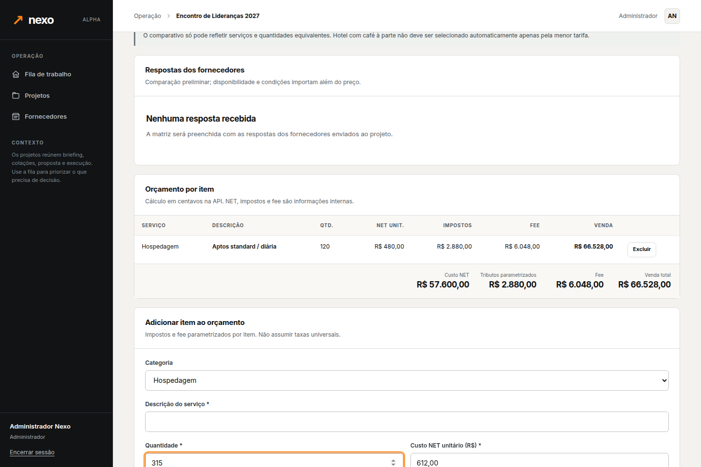

### Wizard por serviço
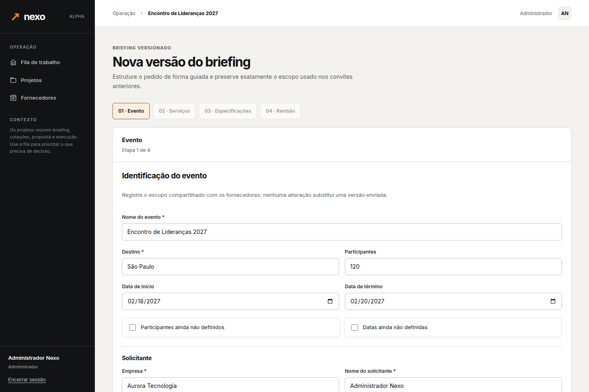

### Versão V2 registrada na API
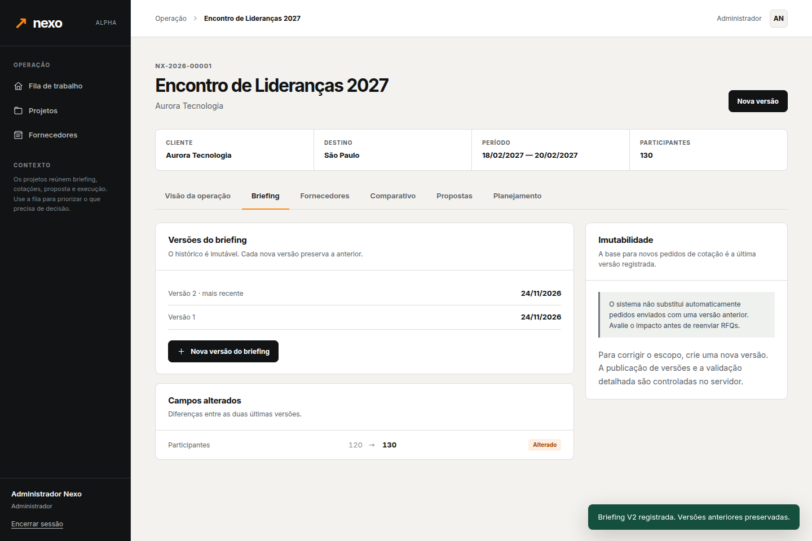

### Workspace mobile
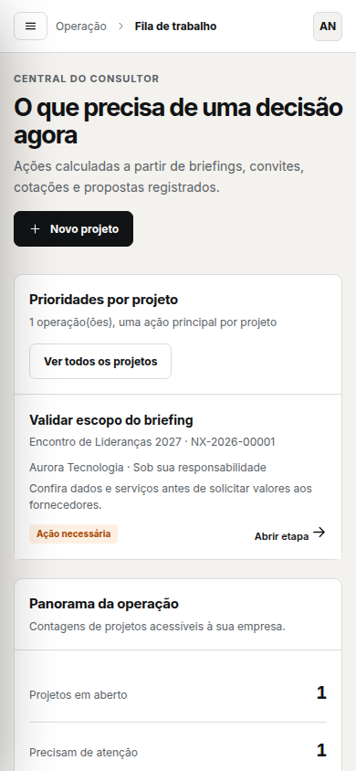
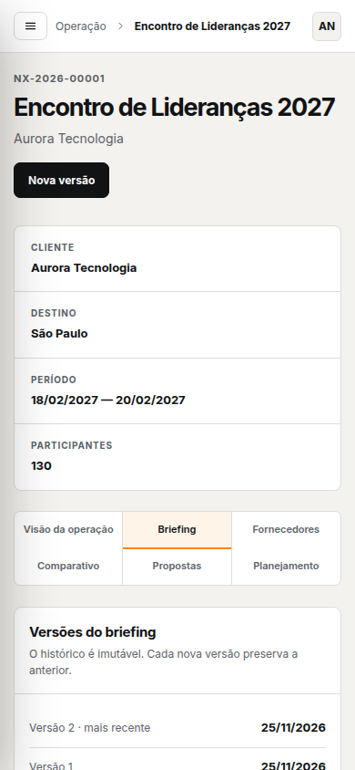

[Manifesto técnico com data, branch e dimensões](manifest.json) · [Brandbook v2.1](../../design/brandbook-v2/BRANDBOOK_V2.md) · [Roadmap](../../governanca/ROADMAP.md)

**Limite:** screenshot não atesta correção de permissões, acessibilidade completa, autenticação em produção, LGPD ou entrega de e-mails. O marcador Alpha e o nome NEXO são provisórios.
